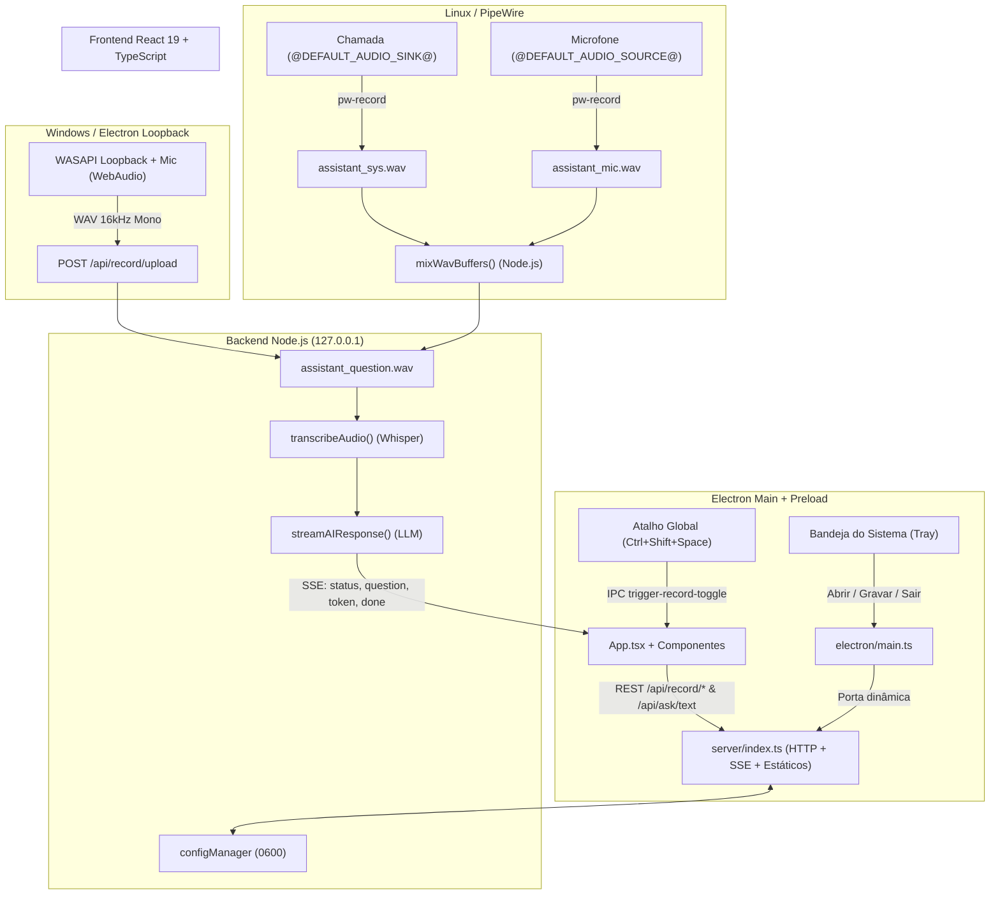

# 🎙️ Assistente Pessoal de Voz

> Copiloto desktop nativo para **Linux** (PipeWire) e **Windows** (WASAPI Loopback via Electron), com bandeja do sistema, atalho global de teclado, transcrição via Whisper e respostas de IA em tempo real por streaming (SSE).

[](LICENSE)
[%20%7C%20Windows%20(WASAPI)-informational.svg)]()
[]()
[]()
[]()

---

## 📋 Índice

- [Visão Geral](#-visão-geral)
- [Funcionalidades Principais](#-funcionalidades-principais)
- [Arquitetura e Fluxo de Funcionamento](#️-arquitetura-e-fluxo-de-funcionamento)
- [Stack Tecnológica](#️-stack-tecnológica)
- [Provedores e Modelos Suportados](#-provedores-e-modelos-suportados)
- [Pré-requisitos](#-pré-requisitos)
- [Instalação e Execução](#-instalação-e-execução)
- [Como Usar Durante Chamadas](#-como-usar-durante-chamadas)
- [Configuração e Persistência Local](#️-configuração-e-persistência-local)
- [Atalhos de Teclado](#️-atalhos-de-teclado)
- [Referência da API Local (HTTP & SSE)](#-referência-da-api-local-http--sse)
- [Scripts, Empacotamento e CI/CD](#-scripts-empacotamento-e-cicd)
- [Testes](#-testes)
- [Estrutura do Projeto](#-estrutura-do-projeto)
- [Licença](#-licença)

---

## 🌟 Visão Geral

O **Assistente Pessoal de Voz** é uma aplicação desktop compacta desenvolvida para atuar como copiloto ao vivo durante reuniões, entrevistas técnicas, sessões de pair programming e chamadas em plataformas como **Google Meet**, **Zoom**, **Microsoft Teams**, **Discord** e **Slack**.

Aplicações web executadas no navegador não conseguem capturar diretamente o áudio recebido de outros participantes sem depender do compartilhamento manual de aba/tela. Este projeto resolve essa limitação no **Linux** via **PipeWire** (`pw-record`) e no **Windows** via **WASAPI Loopback** nativo do Electron (`audio: 'loopback'`), permitindo capturar:
1. **Somente a chamada (`system`)** — o áudio que chega nos seus fones de ouvido ou alto-falantes;
2. **Somente o microfone (`mic`)** — a sua própria voz;
3. **Modo misto (`mixed`)** — gravação simultânea da chamada e do microfone, combinados em memória em um único arquivo WAV PCM mono de 16 kHz.

O áudio capturado é transcrito via **Whisper** e enviado para o modelo de linguagem escolhido, exibindo a resposta token a token em tempo real na janela flutuante (**Always on Top**). Também é possível digitar ou colar perguntas manualmente e alternar toda a interface e as respostas entre **Português (PT-BR)** e **Inglês (EN)**.

---

## ✨ Funcionalidades Principais

- **🖥️ Janela Desktop Flutuante (`Electron`) + Bandeja do Sistema (`Tray`):** cartão compacto (`440×760`, redimensionável entre `380×520` e largura máxima de `640px`), configurado para permanecer sobreposto às demais janelas (`alwaysOnTop: true`), com bloqueio de instância única, minimização opcional para a bandeja ao fechar, opção de iniciar com o sistema (`--hidden`) e isolamento seguro via `contextBridge`.
- **⌨️ Atalho Global de Sistema (`Ctrl + Shift + Space`):** inicia e encerra gravações de áudio mesmo quando outra janela (Meet, Zoom, IDE, navegador) está em foco, restaurando a janela caso esteja minimizada na bandeja.
- **🎧 Captura de Áudio em Nível de Sistema (Linux & Windows):**
  - **Linux (`pw-record` / PipeWire):** captura `@DEFAULT_AUDIO_SINK@` (com `stream.capture.sink = true`) e `@DEFAULT_AUDIO_SOURCE@` com mixagem PCM 16-bit em Node.js puro (`mixWavBuffers`), incluindo suporte automático a `flatpak-spawn --host`.
  - **Windows (`audio: 'loopback'` nativo do Electron):** captura áudio WASAPI loopback do sistema + microfone via WebAudio, converte para WAV PCM 16 kHz mono e envia ao backend local via `POST /api/record/upload` sem exigir cabos virtuais (VB-Cable) ou "Mixagem Estéreo".
- **⌨️ Entrada Manual por Texto:** envie dúvidas digitadas ou coladas diretamente sem gravação de áudio (`POST /api/ask/text`).
- **🌐 Bilíngue (PT-BR / EN):** seletor instantâneo no cabeçalho e nas configurações que adapta a interface, o parâmetro de idioma enviado ao Whisper e os prompts de sistema enviados à IA.
- **🎭 Personas de Resposta Configuráveis:**
  - **Reunião Concisa (`concise_meeting`)**: resposta direta logo na primeira frase + tópicos técnicos objetivos.
  - **Entrevista Técnica (`job_interview`)**: definição conceitual, exemplos práticos, arquitetura e trade-offs.
  - **Copiloto de Código (`coding`)**: explicação imediata, snippet limpo, complexidade Big-O e edge cases.
  - **Prompt Customizado (`custom`)**: instruções livres definidas pelo usuário.
- **🗂️ Histórico da Sessão:** painel dedicado com contagem de consultas, busca por pergunta/resposta/modelo, visualização detalhada formatada, botões de cópia rápida, recarregamento no assistente principal, exclusão individual e limpeza total da sessão.
- **🔒 Privacidade e Segurança Local:** chaves de API armazenadas apenas localmente com permissão restrita ao dono (`0600` no Linux em `~/.config/audio-call-assistant/config.json`, ou `%APPDATA%\audio-call-assistant\config.json` no Windows), mascaradas no `GET /api/config` e protegidas contra sobrescrita parcial; áudios temporários são removidos logo após a transcrição. O servidor local (`127.0.0.1`) restringe CORS a origens `localhost`/`127.0.0.1`, valida caminhos estáticos contra *path traversal* e o Electron bloqueia navegação externa. Suporte completo à execução **100% offline** via **Ollama**.
---

## 🏗️ Arquitetura e Fluxo de Funcionamento



### Etapas do Pipeline

1. **Inicialização Unificada:** ao abrir o aplicativo Desktop, `electron/main.ts` inicia o servidor embutido em porta dinâmica livre (`0`, ou `5000` no modo dev/`--web`), aplica trava de instância única, cria a bandeja do sistema (`Tray`), configura os handlers de loopback/permissões e registra o atalho global `CommandOrControl+Shift+Space`.
2. **Captura & Mixagem PCM (16 kHz Mono s16le):**
   - **Linux:** `AudioCaptureManager` inicia processos `pw-record` e, no modo `mixed`, soma os samples via `mixWavBuffers()` em memória.
   - **Windows:** `RendererAudioCapture` usa `getDisplayMedia` (`audio: 'loopback'`) + `getUserMedia`, mixa em WebAudio (`AudioWorklet` com fallback) e envia o WAV via `POST /api/record/upload`.
3. **Transcrição (STT):** `transcribeAudio()` envia o arquivo WAV via `multipart/form-data` para o provedor configurado (`Groq` ou `OpenAI`) com `temperature=0` e código de idioma (`pt` ou `en`), removendo o arquivo temporário em seguida.
4. **Geração em Streaming (SSE):** o frontend abre `EventSource` em `GET /api/ask/stream?jobId=...` e recebe tokens em tempo real de **Groq**, **OpenAI**, **OpenRouter**, **Google Gemini** ou **Ollama**.

---

## 🛠️ Stack Tecnológica

| Camada | Tecnologias Utilizadas |
| :--- | :--- |
| **Desktop** | Electron `45.2.3`, `Tray`, `contextBridge` (IPC), `globalShortcut`, `electron-builder` `26.18.0` |
| **Frontend** | React `19.0.0`, TypeScript `5.7.3`, Vite `6.1.0`, Lucide React `1.16.0`, CSS Design Tokens |
| **Backend** | Node.js HTTP nativo (`node:http`), Server-Sent Events (SSE), Fetch API nativa |
| **Áudio** | Linux: PipeWire (`pw-record` / `flatpak-spawn`) + mixer PCM; Windows: WASAPI `audio: 'loopback'` + WebAudio `AudioWorklet` |
| **Build & Dev** | `esbuild` (bundle CJS do Electron), `vite` (bundle SPA), `tsx` (execução TS direta) |
| **CI/CD** | GitHub Actions (`ubuntu-latest` + `windows-latest`, Node `22`) gerando `.AppImage`, `.deb`, `Setup.exe` e `Portable.exe` |
---

## 🧠 Provedores e Modelos Suportados

### Modelos de Linguagem (LLM)

| Provedor | Modelos Disponíveis | Padrão | Requer Chave de API |
| :--- | :--- | :--- | :--- |
| **Groq** | `qwen/qwen3.8-27b`, `openai/gpt-oss-120b`, `openai/gpt-oss-20b` | `qwen/qwen3.8-27b` | Sim (`GROQ_API_KEY`) |
| **OpenAI** | `gpt-4o-mini`, `gpt-4o`, `o3-mini` | `gpt-4o-mini` | Sim (`OPENAI_API_KEY`) |
| **Google Gemini** | `gemini-2.0-flash`, `gemini-1.5-flash`, `gemini-1.5-pro` | `gemini-2.0-flash` | Sim (`GEMINI_API_KEY`) |
| **OpenRouter** | `meta-llama/llama-3.1-8b-instruct:free`, `deepseek/deepseek-chat`, `anthropic/claude-3.5-haiku` | `meta-llama/llama-3.1-8b-instruct:free` | Sim (`OPENROUTER_API_KEY`) |
| **Ollama (Local)** | `llama3.2`, `qwen2.5-coder:7b`, `mistral` | `llama3.2` | Não (URL local) |

### Modelos de Transcrição (Speech-to-Text)

| Provedor STT | Modelos Disponíveis | Padrão |
| :--- | :--- | :--- |
| **Groq** | `whisper-large-v3`, `whisper-large-v3-turbo` | `whisper-large-v3` |
| **OpenAI** | `whisper-1` | `whisper-1` |

> **Nota:** Caso uma configuração antiga utilize modelos descontinuados do Groq (`llama-3.3-70b-versatile`, `llama-3.1-8b-instant`, `deepseek-r1-distill-llama-70b` ou `mixtral-8x7b-32768`), o `configManager` realiza a migração automática para `qwen/qwen3.8-27b`.

---

## 💻 Pré-requisitos

- **Linux:** **PipeWire** ativo e comando `pw-record` instalado (padrão em Ubuntu 22.04+, Fedora 34+, Debian 12+, Arch Linux, Pop!_OS, Manjaro).
- **Windows:** Windows 10/11 (x64) usando o aplicativo Desktop Electron (captura loopback WASAPI integrada, sem dependências externas).
- **Node.js (apenas para rodar via código-fonte):** versão `20.x` ou `22.x` (com `npm`).
- **Opcional (Modo Offline):** [Ollama](https://ollama.com/) em execução local (padrão `http://localhost:11434`).

No Linux, verifique rapidamente se o PipeWire está disponível:

```bash
which pw-record && pw-record --version
```

---

## 🚀 Instalação e Execução

### 1. Clonar o repositório e instalar dependências

```bash
git clone https://github.com/kauavn/audio-call-assistant.git
cd audio-call-assistant
npm install
```

### 2. Executar o aplicativo Desktop no Linux (forma recomendada)

O script `start.sh` instala dependências ausentes, recompila automaticamente quando detectar alterações no código (ou com `--rebuild`), cria/atualiza o atalho no menu de aplicativos (`~/.local/share/applications/assistente-pessoal-de-voz.desktop`), registra o comando global `assistente-voz` em `~/.local/bin` e abre a janela nativa do Electron:

```bash
chmod +x start.sh
./start.sh
```

Após a primeira execução, o app pode ser aberto diretamente pelo menu de aplicativos ou digitando `assistente-voz` em qualquer terminal. Use `./start.sh --hidden` para iniciar direto na bandeja ou `./start.sh --rebuild` para forçar recompilação.

Para executar apenas no navegador no Linux (servidor na porta `5000` abrindo `http://127.0.0.1:5000`):

```bash
./start.sh --web
```

### 3. Executar no Windows

- **Instalador / Portátil (recomendado):** baixe `Assistente-Pessoal-de-Voz-*-Setup.exe` ou `Assistente-Pessoal-de-Voz-*-Portable.exe` na aba **Releases** (ou nos artefatos do workflow **Release Desktop App** no GitHub Actions).
- **Via código-fonte:**

```powershell
npm install
npm run build
npm run dev:win
```

### 4. Modo de Desenvolvimento (Frontend + Backend separados)
Caso queira rodar o backend com *hot-reload* e o Vite Dev Server na porta `5173` (com proxy `/api` → `http://localhost:5000`):

```bash
# Terminal 1 — Servidor backend
npm run dev:server

# Terminal 2 — Frontend Vite
npm run dev:client
```

Ou para compilar o processo principal do Electron e abrir o aplicativo Desktop diretamente:

```bash
npm run build:client
npm run dev
```

---

## 📞 Como Usar Durante Chamadas

1. **Configure suas chaves de API:** clique no ícone de engrenagem (**Configurações**) no canto superior direito, escolha o idioma (**Português** ou **English**), o provedor/modelo de IA, o provedor de transcrição (**Whisper**) e o estilo de resposta do copiloto. Salve as configurações.
2. **Escolha a fonte de áudio:**
   - **Misto:** captura sua voz + áudio de quem está na chamada (ideal para diálogos completos).
   - **Chamada:** captura apenas o áudio reproduzido pelos participantes no fone/alto-falante.
   - **Microfone:** captura apenas o que você falar.
3. **Posicione a janela:** deixe o aplicativo ao lado da janela da videochamada (a janela inicia configurada como sempre no topo).
4. **Grave a pergunta:** pressione **`Ctrl + Shift + Space`** (em qualquer janela do sistema) ou **`Space`** (com o app focado), ou clique em **Gravar pergunta**.
5. **Receba a resposta:** pressione o atalho novamente para parar a gravação. Em instantes, a transcrição e a resposta em Markdown surgem via streaming com opção de cópia rápida e registro automático no **Histórico da sessão**.

---

## ⚙️ Configuração e Persistência Local

As preferências e chaves são gravadas automaticamente em:

- **Arquivo de configuração:** `~/.config/audio-call-assistant/config.json` (Linux) ou `%APPDATA%\audio-call-assistant\config.json` (Windows)
- **Áudios temporários de gravação:** subpasta `temp/` no mesmo diretório (`assistant_question.wav`, limpo automaticamente após cada transcrição)

### Variáveis de Ambiente Opcionais

Na criação inicial de `config.json` (ou para customizar a porta do servidor), o backend lê:

| Variável | Descrição | Padrão |
| :--- | :--- | :--- |
| `PORT` | Porta TCP do servidor local (`127.0.0.1`) | Dinâmica (`0`) no Electron / `5000` em modo servidor |
| `GROQ_API_KEY` | Chave inicial da API Groq | `""` |
| `OPENAI_API_KEY` | Chave inicial da API OpenAI | `""` |
| `GEMINI_API_KEY` | Chave inicial da API Google Gemini | `""` |
| `OPENROUTER_API_KEY` | Chave inicial da API OpenRouter | `""` |

---

## ⌨️ Atalhos de Teclado

| Atalho | Escopo | Ação |
| :--- | :--- | :--- |
| **`Ctrl + Shift + Space`** | **Global (Sistema / Electron)** | Inicia ou encerra a gravação mesmo com outra janela em foco |
| **`Space`** | Na janela do app | Inicia ou encerra a gravação (desativado ao digitar em inputs ou modais abertos) |
| **`Enter`** | Campo de pergunta manual | Envia a pergunta digitada para a IA |
| **`Escape`** | Drawer de histórico | Volta da visualização de detalhes ou fecha o histórico |

---

## 🔌 Referência da API Local (HTTP & SSE)

O servidor embutido (`server/index.ts`) escuta em `http://127.0.0.1:5000` e expõe os seguintes endpoints:

| Método | Rota | Descrição |
| :--- | :--- | :--- |
| `GET` | `/api/config` | Retorna as configurações atuais com chaves de API mascaradas (`xxxx••••yyyy`) |
| `POST` | `/api/config` | Atualiza parcialmente `config.json` (preserva chaves reais se receber valor mascarado) |
| `GET` | `/api/models` | Retorna o catálogo de modelos LLM (`providers`) e Whisper (`stt`) |
| `GET` | `/api/record/status` | Retorna `{ isRecording, elapsedSec, mode }` da captura atual |
| `POST` | `/api/record/start` | Inicia gravação PipeWire no Linux no modo informado (`mixed`, `system` ou `mic`) |
| `POST` | `/api/record/stop` | Finaliza gravação no Linux, mixa se necessário e retorna `{ ok, jobId, durationSec, mode }` |
| `POST` | `/api/record/upload` | Recebe áudio WAV (`audio/wav`) capturado pelo Electron no Windows e retorna `{ ok, jobId, durationSec, mode }` |
| `POST` | `/api/record/toggle` | Alterna início/parada de gravação (retorna `state: 'recording'` ou `'stopped'` com `jobId`) |
| `POST` | `/api/ask/text` | Cria um job a partir de pergunta em texto (`{ question }`) e retorna `{ ok, jobId }` |
| `GET` | `/api/ask/stream?jobId=...` | Abre stream **SSE** emitindo eventos `status`, `question`, `token`, `done` e `server-error`/`error` |
| `GET` | `/api/history` | Lista o histórico em memória da sessão atual |
| `POST` | `/api/history` | Adiciona manualmente um item ao histórico da sessão |
| `DELETE` | `/api/history` | Remove todos os itens ou um item específico via `?id=...` |

---

## 📦 Scripts, Empacotamento e CI/CD

### Scripts disponíveis no `package.json`

| Comando | Ação |
| :--- | :--- |
| `npm run dev` / `npm run dev:app` | Compila Electron (`esbuild`) e abre o app no Linux (`--no-sandbox`) |
| `npm run dev:win` | Compila Electron (`esbuild`) e abre o app no Windows |
| `npm run dev:server` | Inicia `server/index.ts` com reload automático via `tsx watch` |
| `npm run dev:client` | Inicia o servidor Vite na porta `5173` com proxy para `/api` |
| `npm run build:client` | Compila o frontend React para `dist/client/` |
| `npm run build:electron` | Empacota `main.ts` e `preload.ts` para CommonJS em `dist/electron/` |
| `npm run build` | Executa `build:client` + `build:electron` |
| `npm run start` | Sobe o servidor Node.js diretamente via `tsx server/index.ts` |
| `npm run dist` | Gera build completo + pacotes Linux (`AppImage` e `deb`) em `release/` |
| `npm run dist:appimage` | Gera apenas o pacote portátil `.AppImage` |
| `npm run dist:deb` | Gera apenas o pacote `.deb` (Debian/Ubuntu) |
| `npm run dist:win` | Gera instalador NSIS (`Setup.exe`) e executável portátil (`Portable.exe`) no Windows |
| `npm run pack` | Gera build empacotado em diretório sem instalador final (`electron-builder --dir`) |
| `npm run test:audio` | Executa a suíte de testes de mixagem WAV e captura real via PipeWire |
| `npm run test:ai` | Executa a suíte de validação de configurações, catálogo e rotas HTTP/SSE |

### Releases Automatizadas via GitHub Actions

O workflow [`.github/workflows/release.yml`](.github/workflows/release.yml) executa em paralelo em `ubuntu-latest` e `windows-latest` (Node.js 22) via `workflow_dispatch` (disponibilizando os binários como artefatos do workflow) ou ao enviar uma tag `v*` (publicando `.AppImage`, `.deb`, `*-Setup.exe` e `*-Portable.exe` na aba **Releases** do GitHub):

```bash
git tag v1.0.0
git push origin v1.0.0
```

---
## 🧪 Testes

### Teste de Áudio e Mixagem PCM

Valida criação de buffers WAV sintéticos (`440 Hz` + `880 Hz`), parsing de chunks RIFF (`extractPcmData`), mixagem com clamping (`mixWavBuffers`) e gravações reais de 1,2s via PipeWire nos modos `system` e `mixed`:

```bash
npm run test:audio
```

### Teste de Backend, Configurações e Endpoints HTTP/SSE

Valida `configManager` (PT e EN), catálogo de modelos e as rotas `/api/config`, `/api/models`, `/api/record/status`, `/api/ask/text`, `/api/ask/stream` (SSE) e `/api/history`. *(Requer o servidor backend em execução na porta `5000`)*:

```bash
# Em um terminal:
npm run start

# Em outro terminal:
npm run test:ai
```

---

## 📂 Estrutura do Projeto

```text
audio-call-assistant/
├── .github/
│   └── workflows/
│       └── release.yml                # Pipeline CI/CD Linux (.AppImage/.deb) e Windows (.exe)
├── build/                             # Ícones empacotados (.png, tray.png, .ico) gerados de icon.svg
├── client/                            # Frontend Web/Desktop (React 19 + TypeScript + Vite)
│   ├── index.html                     # Documento HTML base (PT-BR, fontes Inter e JetBrains Mono)
│   └── src/
│       ├── main.tsx                   # Ponto de entrada ReactDOM (StrictMode)
│       ├── App.tsx                    # Orquestrador de estado, captura Windows, SSE e atalhos
│       ├── index.css                  # Design tokens (ocean-light) e estilos globais/componentes
│       ├── i18n.ts                    # Dicionário completo de traduções PT-BR e EN
│       ├── types.ts                   # Tipagens compartilhadas e interface ElectronAPI
│       ├── utils/
│       │   └── rendererAudioCapture.ts # Captura loopback+mic via WebAudio e encoder WAV 16 kHz
│       └── components/
│           ├── Header.tsx             # Cabeçalho: idioma, seletor rápido de modelo, histórico e config
│           ├── RecordingControl.tsx   # Seletor de fonte (Misto/Chamada/Mic), botão gravar e input manual
│           ├── AnswerView.tsx         # Exibição de pergunta, erros, streaming e renderizador Markdown
│           ├── HistoryDrawer.tsx      # Painel de histórico com busca, detalhes, cópia e exclusão
│           └── SettingsModal.tsx      # Modal de idioma, provedores LLM/STT, keys, prompt e bandeja
├── electron/                          # Camada Desktop nativa (Electron)
│   ├── main.ts                        # Processo principal, servidor embarcado, Tray, loopback e hotkeys
│   └── preload.ts                     # ContextBridge expondo window.electronAPI com segurança
├── server/                            # Backend Node.js (API HTTP + SSE + Áudio + IA)
│   ├── index.ts                       # Servidor HTTP/SSE, rotas /api/* (incl. /upload) e estáticos
│   ├── audioCapture.ts                # Captura PipeWire no Linux (pw-record) e mixer PCM WAV
│   ├── aiEngine.ts                    # Catálogo de modelos, Whisper STT e streaming multi-provedor
│   └── configManager.ts               # Persistência (%APPDATA% / ~/.config), keys e system prompts
├── tests/                             # Scripts de verificação automatizada
│   ├── test_audio.ts                  # Testes unitários do mixer WAV + captura real PipeWire
│   └── test_ai.ts                     # Testes de configManager, catálogo e endpoints HTTP/SSE
├── .gitignore                         # Regras de exclusão (node_modules, dist, release, logs, WAVs temp)
├── icon.svg                           # Ícone vetorial fonte da aplicação
├── LICENSE                            # Licença MIT
├── package.json                       # Dependências, scripts NPM e alvos Linux/Windows do builder
├── package-lock.json                  # Lockfile exato das dependências NPM
├── README.md                          # Documentação do projeto para o GitHub
├── start.sh                           # Launcher Linux (dependências, rebuild inteligente, .desktop e CLI)
├── tsconfig.json                      # Configuração do compilador TypeScript
└── vite.config.ts                     # Configuração do bundler Vite e proxy de desenvolvimento
```

---

## 📄 Licença

Este projeto está licenciado sob a **Licença MIT** — veja o arquivo [LICENSE](LICENSE) para mais detalhes.
